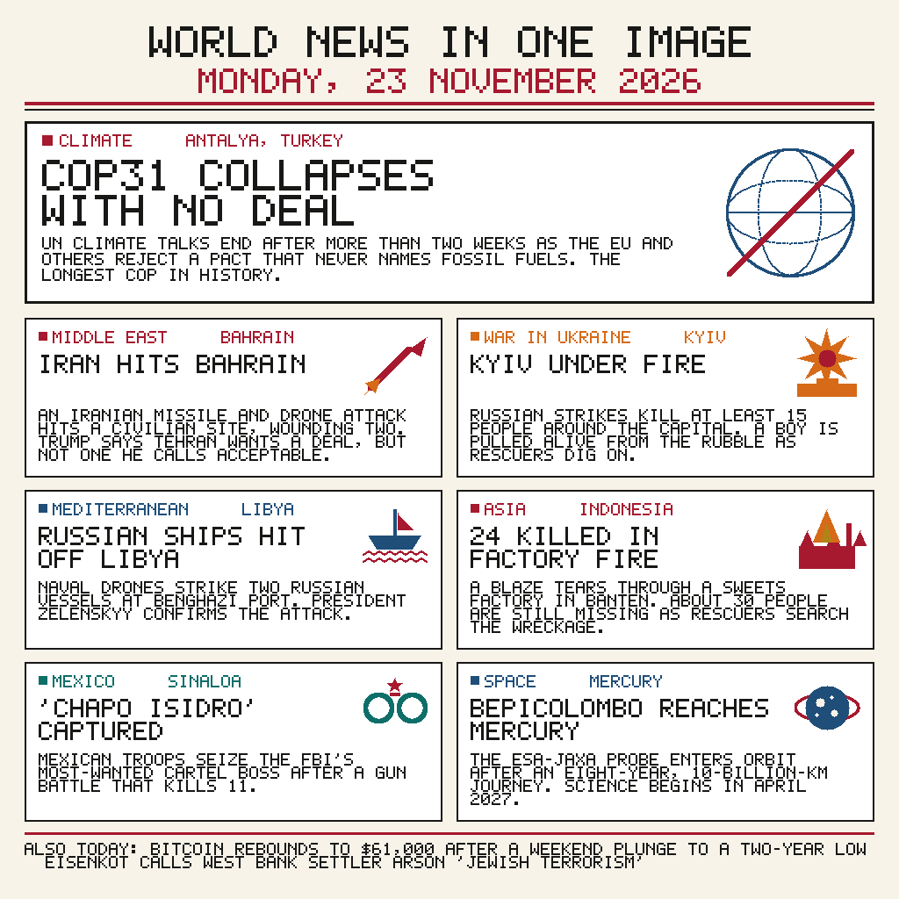

# World news in one image — 23 November 2026

[](https://make.fun/bounty/news-image-20261123)
[](https://make.fun/bounty/news-image-20261123)
[](https://make.fun/bounty/news-image-20261123)

Entry for the [make.fun](https://make.fun) bounty
[news-image-20261123](https://make.fun/bounty/news-image-20261123):
sum up the world's news of Monday 23 November 2026 in one image.

## The image



Seven stories from the day, plus a ticker of two more:

1. **COP31 collapses with no deal** — UN climate talks in Antalya, Turkey,
   end after a record two weeks as the EU and others reject a pact that
   never names fossil fuels.
2. **Iran hits Bahrain** — a missile and drone attack on a civilian site
   wounds two; Trump says Tehran wants a deal, but not one he calls
   acceptable.
3. **Kyiv under fire** — Russian strikes kill at least 15 people around
   the Ukrainian capital.
4. **Russian ships hit off Libya** — Ukrainian naval drones strike two
   Russian vessels at Benghazi port; Zelenskyy confirms the attack.
5. **24 killed in factory fire** — a sweets factory blaze in Banten,
   Indonesia; about 30 people still missing.
6. **'Chapo Isidro' captured** — Mexican troops seize the FBI's
   most-wanted cartel boss after a gun battle that kills 11.
7. **BepiColombo reaches Mercury** — the ESA-JAXA probe enters orbit
   after an eight-year, 10-billion-km journey.

## How it runs

`main.py` (Python 3.13, standard library only) copies the bundled
`entry.png` (1024×1024, under 1 MiB) to `$MAKEFUN_OUTPUT_DIR`
(default `/output`). No network, fully deterministic — both runs
write identical bytes.

```sh
mkdir -p out && MAKEFUN_OUTPUT_DIR=out python3 main.py
```

## License

MIT — see [LICENSE](LICENSE). SPDX-License-Identifier: MIT.
